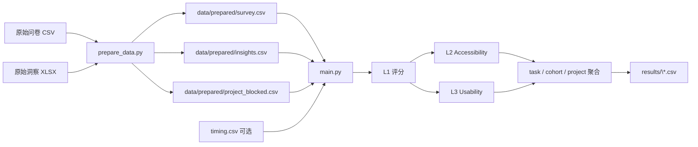

# Katie Model C3 — 网站无障碍与可用性评分引擎

<p align="center">
  
  
  
  
</p>

一个把**网站用户测试数据**（问卷评分 + 摩擦洞察 + 任务计时）转换成**多层级、可解释评分**的 Python 命令行工具。原始版本为 AAMI 保险网站的多人群可用性测试而构建，评分模型称为 **Katie Model C3**。

它回答三个问题：

1. **每个参与者在每个任务上表现如何？** → L1 任务分
2. **无障碍群体是否被界面拦住？** → L2 Accessibility 分
3. **整体使用体验如何？** → L3 Usability 分

最终按 任务 → 人群（cohort）→ 项目 三级聚合，输出四张 CSV。

> 仓库里的 `CLAUDE.md` 是给 AI 编码助手看的项目说明；本 README 面向人类读者，内容更完整。

---

## 目录

- [1. 项目背景](#1-项目背景)
- [2. 评分模型总览](#2-评分模型总览)
- [3. 功能特性](#3-功能特性)
- [4. 数据流与项目结构](#4-数据流与项目结构)
- [5. 快速开始](#5-快速开始)
- [6. 输入数据格式](#6-输入数据格式)
- [7. 输出文件与实测结果](#7-输出文件与实测结果)
- [8. 评分规则详解](#8-评分规则详解)
- [9. 聚合与特殊处理](#9-聚合与特殊处理)
- [10. 洞察去重（预处理）](#10-洞察去重预处理)
- [11. AAMI 数据适配层](#11-aami-数据适配层)
- [12. 配置与调参](#12-配置与调参)
- [13. 测试](#13-测试)
- [14. 数据隐私提示](#14-数据隐私提示)
- [15. 已知限制与扩展方向](#15-已知限制与扩展方向)
- [16. 许可与数据说明](#16-许可与数据说明)

---

## 1. 项目背景

传统可用性测试通常只产出一个平均分（例如 SUS 量表），但这对**无障碍**评估是不够的：一个屏幕阅读器用户在关键任务上被彻底挡住（categorical failure），与一个普通用户觉得"有点慢"，不应该用同一种方式计入总分。

本项目实现的三层模型把两种关注点拆开：

- **Accessibility（无障碍）**：辅助技术（AT）摩擦、理解障碍是否让特定人群无法完成任务；
- **Usability（可用性）**：交互、文案、性能等一般性摩擦对体验的影响。

原始数据来自 AAMI 保险网站的用户测试：21 名参与者、11 个任务、6 类人群（ESL、Deaf、Neurodivergent、Blind/Low Vision、Older Adult、General），包含问卷评分、逐条摩擦洞察（friction insights）与任务耗时。仓库同时保留了原始数据、预处理脚本和最终结果，方便复现。

## 2. 评分模型总览

所有分数都是 **0–100**，分数只能从 L1 的"自评分上限"往下扣，不会被规则抬高（除了一个正向保底规则 L1.5）。

| 层级 | 模块 | 含义 | 起点 | 主要规则 |
| --- | --- | --- | --- | --- |
| **L1** | `l1_scorer.py` | 任务/组件得分上限 | 参与者自评 `ease_of_use_score` | AT 阻塞 → 0 分；高严重度 AT 摩擦 → 封顶 10/20 |
| **L2** | `l2_scorer.py` | 无障碍分（Accessibility） | L1 分 | AT 摩擦封顶 + 理解摩擦封顶（按人群权重缩放） |
| **L3** | `l3_scorer.py` | 可用性分（Usability） | L1 分（与 L2 独立） | 可用性摩擦封顶 + 理解摩擦（按人群权重）+ 期望落差 + 耗时封顶 |

关键设计：

- **L2 与 L3 独立**：L3 也从 L1 出发，不继承 L2 的结果，因此可以出现"无障碍分低但可用性分高"的组合。
- **规则有编号**：代码 docstring 中使用 `L1.2`、`L2.6`、`L3.8` 这类规则 ID，对应评分规范（`Katie_Model_C3_corrected.docx`），改逻辑时应保持编号一致。
- **人群感知**：理解类摩擦对无障碍流和可用性流的影响不同，由 `COHORT_WEIGHTS` 中每个人的 `(acc, usa)` 权重决定。
- **置信度缩放**：摩擦洞察带有 0–1 的置信度，只有置信度 > 0.70 的洞察才生效，且封顶力度随置信度线性增加。

## 3. 功能特性

- **两阶段流水线**：`prepare_data.py`（AAMI 专用数据适配）→ `main.py`（通用评分），两阶段解耦。
- **四张输出表**：参与者×任务明细、任务聚合、人群×任务聚合、项目汇总。
- **语义去重**：同一参与者同一任务下相似度 > 0.85 的洞察自动合并（TF-IDF 余弦，缺少 scikit-learn 时回退到 `difflib`），并保留更高的严重度与置信度。
- **分类型失败处理**：AT 阻塞（blocked/severe + 置信度 > 70%）直接判 0 分，并从任务/人群均值中排除，而不是稀释平均分。
- **项目级阻塞**：`project_blocked.csv` 中的人对项目无障碍分贡献 0，但不会抹掉其可用性数据。
- **耗时调节**：相对任务中位耗时 2×/3×/4× 分别触发 50/40/25 的封顶。
- **输入校验**：缺列、超出范围（置信度不在 0–1、自评分不在 0–100、耗时为负）都会明确报错退出。
- **可测试**：5 个单元测试覆盖 L1/L2/L3 关键规则、去重与聚合。

## 4. 数据流与项目结构



```text
Model-C_Claude_version/
├─ main.py                      # 评分 CLI：加载 → 校验 → L1/L2/L3 → 聚合 → 输出
├─ prepare_data.py              # AAMI 原始数据适配层（硬编码映射）
├─ scoring_engine/
│  ├─ __init__.py
│  ├─ constants.py              # 阈值、人群权重、严重度排序
│  ├─ models.py                 # FrictionInsight / SurveyResponse / TimingRecord 数据类
│  ├─ preprocess.py             # 洞察语义去重（TF-IDF/余弦，difflib 回退）
│  ├─ l1_scorer.py              # L1：任务分上限、阻塞判定、正向保底资格
│  ├─ l2_scorer.py              # L2：无障碍分（AT 封顶 + 理解封顶）
│  ├─ l3_scorer.py              # L3：可用性分（摩擦封顶 + 期望 + 耗时）
│  └─ aggregation.py            # task / cohort / project 三级聚合
├─ tests/
│  └─ test_scoring_engine.py    # 5 个规则测试
├─ data/
│  ├─ *.csv / *.xlsx            # AAMI 原始数据
│  ├─ prepared/                 # prepare_data.py 的产出（已提交）
│  └─ results/                  # 正式运行结果（已提交）
├─ sample_data/                 # 可直接跑通的最小样例（含 timing）
├─ results/                     # 早期 smoke 结果副本
├─ codex_smoke_results/         # 早期 smoke 结果副本
├─ Katie_Model_C3_corrected.docx# 评分规范文档
├─ CLAUDE.md                    # 面向 AI 助手的项目说明
└─ requirements.txt
```

## 5. 快速开始

### 5.1 环境

- Python 3.10+（实测 3.12.3）
- 依赖：`pandas`、`numpy`、`scikit-learn`、`openpyxl`（读 xlsx 用）

```bash
pip install -r requirements.txt
```

### 5.2 用样例数据跑通（推荐先做这一步）

仓库自带 `sample_data/`，无需原始数据即可看到完整输出：

```bash
python main.py \
  --insights sample_data/insights.csv \
  --survey sample_data/survey.csv \
  --timing sample_data/timing.csv \
  --project-blocked sample_data/project_blocked.csv \
  --output sample_results
```

预期：控制台打印项目汇总，并在 `sample_results/` 下生成 4 张 CSV。样例结果约为 accessibility 62.43、usability 62.50。

### 5.3 用真实 AAMI 数据复现

```bash
# 1) 原始 CSV/XLSX → data/prepared/*.csv
python prepare_data.py

# 2) 评分（默认读取 data/prepared/，输出到 data/results/）
python main.py

# 也可以用显式参数
python main.py \
  --insights data/prepared/insights.csv \
  --survey data/prepared/survey.csv \
  --timing data/prepared/timing.csv \
  --project-blocked data/prepared/project_blocked.csv \
  --output data/results
```

> `prepare_data.py` 的输入文件名、列名和映射都是 AAMI 数据专用的；换成其他项目的数据集时，需要改造这一层。

### 5.4 命令行参数

| 参数 | 默认值 | 说明 |
| --- | --- | --- |
| `--insights` | `data/prepared/insights.csv` | 摩擦洞察表（必需） |
| `--survey` | `data/prepared/survey.csv` | 问卷评分表（必需） |
| `--timing` | `None` | 任务耗时表（可选；不提供则跳过耗时规则） |
| `--project-blocked` | `data/prepared/project_blocked.csv` | 项目级阻塞名单（可选） |
| `--output` | `data/results` | 输出目录，不存在会自动创建 |

`--insights` 或 `--survey` 缺失 → 打印 `[error]` 并以退出码 1 结束；其他可选文件找不到则只打印 `[warning]` 并跳过。

## 6. 输入数据格式

### 6.1 `survey.csv`（问卷 / 自评）

| 列 | 类型 | 取值 | 说明 |
| --- | --- | --- | --- |
| `participant_id` | str | 任意唯一标识 | 参与者 ID（AAMI 数据中是邮箱） |
| `task_id` | str | 任意字符串 | 任务 ID，需与 insights 中的 `task_id` 对应 |
| `ease_of_use_score` | int | 0–100 | 自评易用分，作为 L1 上限 |
| `met_expectations` | str | `exceeded` / `met` / `not met` / `fell well below` | 期望达成度，L2/L3 会用到 |
| `cohort` | str | `esl` / `deaf` / `neurodivergent` / `blind_lv` / `older_adult` / `general` | 人群，决定权重 |

### 6.2 `insights.csv`（摩擦洞察）

| 列 | 类型 | 取值 | 说明 |
| --- | --- | --- | --- |
| `participant_id` | str | — | 参与者 ID |
| `task_id` | str | — | 任务 ID |
| `insight_text` | str | 自由文本 | 用于去重的语义文本 |
| `friction_type` | str | `accessibility` / `comprehension` / `usability` / `other` | 摩擦类型；非无障碍/理解类都归入可用性流 |
| `severity` | str | `blocked` / `severe` / `high` / `medium` / `low` | 严重度 |
| `confidence` | float | 0–1 | 置信度，≤ 0.70 不生效 |

### 6.3 `timing.csv`（可选）

| 列 | 类型 | 说明 |
| --- | --- | --- |
| `participant_id` | str | 参与者 ID |
| `task_id` | str | 任务 ID |
| `time_seconds` | float | 任务耗时（秒），必须非负 |

### 6.4 `project_blocked.csv`（可选）

| 列 | 类型 | 说明 |
| --- | --- | --- |
| `participant_id` | str | 被项目级阻塞的参与者 |
| `blocked` | bool（可选） | 存在该列时，仅 `true`/`1`/`yes` 视为阻塞；不存在则整列都算 |

校验规则（`main.py`）：缺必需列、`confidence ∉ [0,1]`、`ease_of_use_score ∉ [0,100]`、`time_seconds < 0` 均会抛 `ValueError` 并退出。

## 7. 输出文件与实测结果

四张 CSV 都写入 `--output` 目录：

| 文件 | 粒度 | 列 |
| --- | --- | --- |
| `participant_task_scores.csv` | 参与者 × 任务 | `participant_id, task_id, cohort, ease_of_use_score, met_expectations, is_blocked, l1_score, l2_accessibility, l3_usability` |
| `task_scores.csv` | 任务 | `task_id, accessibility_mean/std, usability_mean/std` |
| `cohort_scores.csv` | 人群 × 任务 | `cohort, task_id, accessibility_mean/std, usability_mean/std, participant_count` |
| `project_scores.csv` | 项目 | `accessibility_mean/std, usability_mean/std, n_participants_acc, n_participants_usa` |

### 实测结果（AAMI 正式数据）

明细表 231 行 = 21 名参与者 × 11 个任务，其中 4 行被判定为 blocked。

**项目级：**

| 指标 | 均值 | 标准差 | 参与人数 |
| --- | ---: | ---: | ---: |
| Accessibility | **70.41** | 17.61 | 21 |
| Usability | **66.60** | 13.52 | 21 |

**任务级（完整见 `data/results/task_scores.csv`）：**

| 任务 | Accessibility | Usability |
| --- | ---: | ---: |
| Equal Access to Critical Information – Emergency Response Page | 82.57 | 75.35 |
| Discovering insurance providers | 80.01 | 72.48 |
| Thanks for listening AAMI | 77.83 | 70.25 |
| AAMI Website | 76.74 | 69.60 |
| Navigating Frequently Asked Questions | 76.69 | 65.70 |
| Navigating AAMI's Insurance Service Offering | 76.34 | 70.51 |
| Starting a Home and Contents Insurance Quote | 76.14 | 68.60 |
| Navigating information on financial hardship | 74.15 | 67.64 |
| Navigation of sub-landing page – Product Information | 70.09 | 66.06 |
| PDFs and Understanding Terms | 62.86 | 58.48 |
| **Finding Answers** | **51.80** | **46.79** |

可读出的结论：**Finding Answers（搜索 / 在线客服）是两个流的最低点**，PDF 与条款理解次之；应急信息页得分最高。项目级无障碍分略高于可用性分，说明主要问题不在"完全无法访问"，而在"可用性摩擦"。

## 8. 评分规则详解

### 8.1 置信度缩放（L1.4）

封顶值不是硬阈值，而是随摩擦置信度变化：

```text
avg_confidence < 0.70            → cap = 100（不生效）
avg_confidence = 1.00            → cap = nominal_cap（最严格）
0.70 < avg_confidence < 1.00     → 线性插值
```

```text
ratio = (avg_conf - 0.70) / 0.30
effective_cap = nominal_cap + (100 - nominal_cap) × (1 - ratio)
```

### 8.2 L1 — 任务分上限

1. 起点 = `ease_of_use_score`（自评即上限，规则只会往下扣）。
2. **L1.2 分类失败**：存在 `friction_type=accessibility` 且 `severity ∈ {blocked, severe}`、置信度 > 0.70 的洞察 → 该参与者×任务 **L1/L2/L3 全部记 0**，`is_blocked=True`，并从任务/人群均值中排除。
3. **L1.3 高严重度 AT 摩擦封顶**：≥2 条 `high` → 封顶 10；仅 1 条 → 封顶 20（封顶值再按置信度缩放）。
4. **L1.5 正向保底资格**：自评 ≥ 75、期望达到/超出、且没有任何 high/severe/blocked 摩擦 → 资格成立；最终在 L2、L3 计算完成后，把两者都抬到至少 **55**（仅在未 blocked 时）。
5. 说明：`blocked` 的判定只针对 **accessibility** 类型（AAMI 数据中的 blocker 若属于其他类型，不会触发分类失败）。

### 8.3 L2 — 无障碍分

从 L1 分出发，依次应用两组封顶，**最严格者胜出**：

**AT 摩擦封顶（权重固定 1.0）：**

| 触发条件 | 名义封顶 |
| --- | ---: |
| ≥2 条 high | 10 |
| 1 条 high | 20 |
| ≥3 条 medium | 40 |
| 1–2 条 medium | 30 |
| ≥3 条 low | 60 |
| 1–2 条 low | 70 |

**理解摩擦封顶（L2.7，按人群 acc 权重缩放）：**

| 触发条件 | 名义封顶 |
| --- | ---: |
| 任意 high/severe | 40 |
| ≥3 条 medium | 40 |
| 1–2 条 medium | 50 |
| ≥3 条 low | 60 |
| 1–2 条 low | 70 |

**L2.6 期望保底**：若 `met_expectations = exceeded`，理解摩擦最多把分数压到 45，但 AT 摩擦仍可以把分数压到 45 以下（保底取 `min(AT 后分数, 45)`）。

### 8.4 L3 — 可用性分

从 L1 分出发（与 L2 独立）：

| 规则 | 触发条件 | 封顶 |
| --- | --- | ---: |
| L3.1 | 任意 blocked/severe 可用性摩擦，或 ≥3 条 high | 50 |
| L3.2 | 同时存在 high 与 medium | 60 |
| L3.3 | 同时存在 medium 与 low | 75 |
| L3.4 | ≥3 条 medium | 70 |
| L3.5 | ≥3 条 low | 80 |
| L3.6 | 以上全部规则 | 取最低分 |
| L3.7 | `not met` / `fell well below` | ×0.80 / ×0.60 |
| L3.8 | 耗时 ≥2× / ≥3× / ≥4× 任务中位数 | 50 / 40 / 25 |

理解类摩擦在 L3 中同样生效，但使用人群的 **usa 权重**。

### 8.5 人群权重（L2.7）

| cohort | 无障碍权重 acc | 可用性权重 usa |
| --- | ---: | ---: |
| `esl` | 1.0 | 0.4 |
| `deaf` | 1.0 | 0.4 |
| `neurodivergent` | 1.0 | 0.4 |
| `blind_lv` | 0.5 | 0.9 |
| `older_adult` | 0.6 | 0.8 |
| `general` | 0.4 | 1.0 |

直观理解：对 ESL / Deaf / Neurodivergent 人群，理解障碍主要算在**无障碍**账上（acc=1.0），可用性受影响较小（usa=0.4）；普通人群相反。权重作用方式是"按比例削弱封顶压力"：`新分 = 原分 − (原分 − 封顶) × 权重`。

## 9. 聚合与特殊处理

- **任务级**：对未 blocked 的样本取 L2/L3 的均值与标准差（`std` 用 `ddof=1`）。
- **人群×任务级**：额外输出 `participant_count`。
- **项目级**：
  - 每个参与者在未 blocked 任务上取均值，再对这些参与者求均值与标准差；
  - `project_blocked.csv` 中的参与者在无障碍流中强制记 0（即使没有任务行也计入 `n_participants_acc`）；
  - 项目级阻塞**不影响**其可用性贡献（若该参与者有未 blocked 的任务行）。
- **blocked 参与者**：不进入任务/人群/可用性均值，避免用 0 分拉低平均，但又通过 `is_blocked` 标记保留在明细中。

## 10. 洞察去重（预处理）

`scoring_engine/preprocess.py` 在评分前执行，规则：

1. 按 `(participant_id, task_id, friction_type)` 分组；
2. 组内两两计算 `insight_text` 相似度：优先 TF-IDF + 余弦，缺少 `scikit-learn` 时回退 `difflib.SequenceMatcher`；
3. 相似度 > **0.85** 的洞察用并查集合并；
4. 合并后保留：文本取组内第一条、严重度取最高、置信度取最大值。

这样避免同一障碍被多条近似描述重复计数、反复触发封顶。

## 11. AAMI 数据适配层

`prepare_data.py` 把两份原始导出转成标准三表，内含大量 AAMI 专用映射：

- **任务映射**：4 个问卷任务列 → 对应 insights 的 `task_title`；另有 6 个任务使用整体易用分 ×20；`Finding Answers` 用 `(搜索分 + 在线客服分) / 2 ×20`。
- **评分换算**：原始 0–5 分 ×20 转成 0–100，非 0–5 会报错。
- **邮箱别名**：3 组参与者在问卷与洞察中使用不同邮箱，通过 `EMAIL_ALIAS` 合并。
- **人群编码**：`BL/LV/DF/ESL/ND/OL/AB/OT` → 六类 cohort，多编码按优先级取第一个。
- **摩擦类型映射**：`content_not_found`、`excessive_effort` 等 5 类统一归为 `usability`。
- **期望映射**：自由文本 → `exceeded/met/not met/fell well below`。
- **项目级阻塞候选**：在整体 "AAMI Website" 任务上存在 AT blocker 的参与者，写入 `project_blocked.csv`（脚本提示需人工复核）。

运行时会打印 `survey.csv / insights.csv / project_blocked.csv` 的行数以及每个任务的分数来源。

## 12. 配置与调参

所有阈值集中在 `scoring_engine/constants.py`：

| 常量 | 默认 | 用途 |
| --- | ---: | --- |
| `CONFIDENCE_THRESHOLD` | 0.70 | 洞察生效的最低置信度 |
| `COHORT_WEIGHTS` | 见 8.5 | 人群 acc/usa 权重 |
| `SEVERITY_RANK` | low→blocked 0–4 | 去重时比较严重度 |
| `L1_POSITIVE_FLOOR` | 55.0 | L1.5 正向保底分 |
| `L2_COMP_FLOOR` | 45.0 | exceeded 时的理解摩擦保底 |
| `DEDUP_SIMILARITY_THRESHOLD` | 0.85 | 去重相似度阈值 |

L1/L2/L3 中的封顶数值（10/20/30/40/50/60/70/75/80）是规范的一部分，直接写在 scorer 内；调整它们会改变模型行为，需要同步更新测试。

## 13. 测试

```bash
python -m unittest discover -s tests -v
```

实测输出：**Ran 5 tests in 4.669s — OK**。

| 测试 | 覆盖内容 |
| --- | --- |
| `test_l1_accessibility_block_is_categorical_failure` | AT severe 摩擦 → L1=0、is_blocked、无保底资格 |
| `test_l2_exceeded_expectations_floor_only_limits_comprehension` | exceeded 时理解摩擦保底 45 |
| `test_l3_time_cap_applies_after_other_usability_rules` | 3.2× 耗时 → 封顶 40 |
| `test_project_blocked_participants_contribute_zero_to_accessibility` | 项目级阻塞计 0、可用性不受影响、ID 归一化 |
| `test_dedup_keeps_distinct_friction_types_separate` | 去重不跨 friction_type，保留最高严重度与置信度 |

## 14. 数据隐私提示

仓库中的 `data/` 与 `data/prepared/` 包含**真实参与者的邮箱地址与测试反馈**（公开仓库可见）。这是用户调研数据，建议在公开分享前：

- 删除或替换邮箱为匿名 ID（如 `p001`）；
- 只保留 `sample_data/` 和聚合结果；
- 或把仓库转为私有。

`sample_data/` 使用的是虚构 ID，可以安全展示。

## 15. 已知限制与扩展方向

**限制**

- 适配层与 AAMI 的列名、任务名、邮箱强绑定，换数据集需重写 `prepare_data.py`。
- 评分规则来自固定规范（`Katie_Model_C3_corrected.docx`），封顶数值为硬编码常量，不是可学习参数。
- 样本量较小（21 人），人群级统计波动大。
- 没有做统计显著性检验或信度分析。
- 仓库未附带 LICENSE 文件（默认保留所有权利）。
- `results/` 与 `codex_smoke_results/` 是历史副本，与 `data/results/` 内容相近，容易混淆。

**可扩展**

- 把评分规则外置为 YAML/JSON 配置，支持快速实验不同封顶方案。
- 增加置信区间、Bootstrap 与群体差异检验。
- 输出可视化报告（任务雷达图、人群对比图）。
- 将适配层抽象为可插拔的 dataset adapter，支持 SUS、UMUX 等常见问卷。
- 匿名化数据后作为公开示例数据集。

## 16. 许可与数据说明

- 仓库中未提供 LICENSE 文件，代码默认保留所有权利；如需开源请补充许可证。
- 评分模型、规范文档与测试数据来自 Katie Model C3 项目；数据涉及真实参与者，使用与再分发前请确认知情同意范围。
- 依赖库遵循各自许可证：pandas（BSD-3）、numpy（BSD-3）、scikit-learn（BSD-3）、openpyxl（MIT）。
